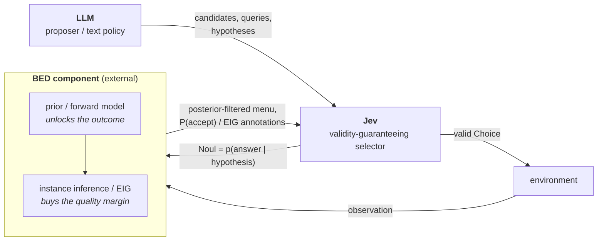
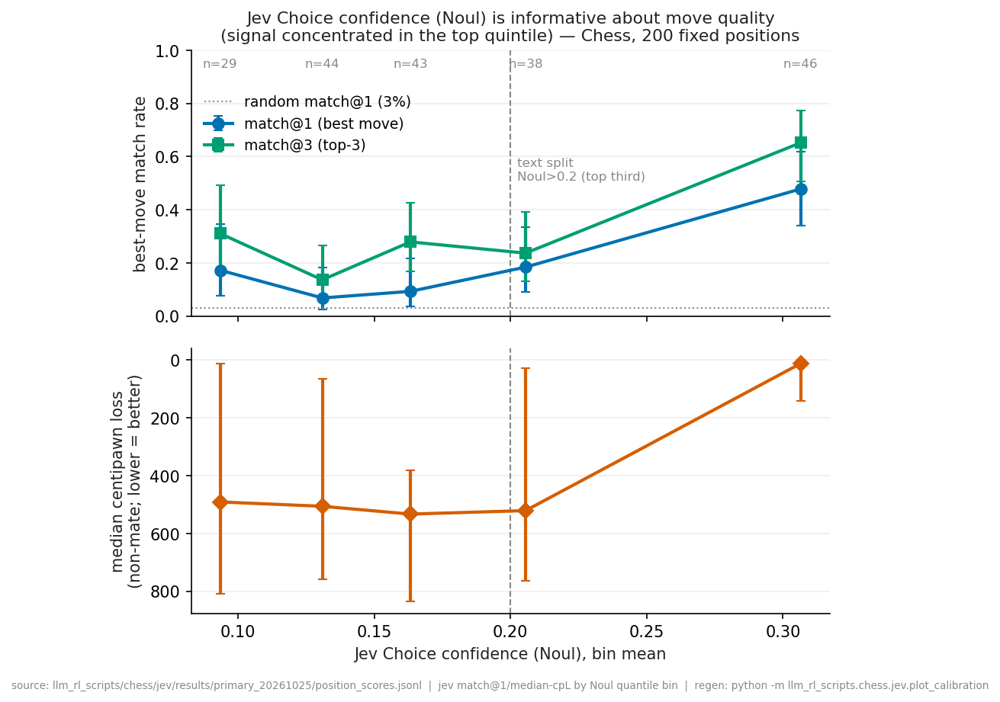

# Jev × LMRL-Gym — Findings & design patterns for Jev / LLM / BED-LLM

_Last updated: 2026-10-27. Synthesis report across the merged benchmark branches._

This report synthesizes the completed experiment programs now on `main` (Text-Nav,
Chess, Wordle, Car-Dealer, 20Q, Binned Car-Dealer) into a single account of **what role
Jev, an LLM, and a BED-style wrapper each play**, and the reusable design patterns that
follow. The companion reference is [`DESIGN_PATTERNS.md`](DESIGN_PATTERNS.md) (the role
table); this is the narrative and the evidence. All terms, run shorthand, metrics, and
source paths are defined in [Appendix A](#appendix-a--definitions-notation--sources).

## 0. Scope & provenance

- **Merged & complete:** Text-Nav (Exp A main run + B/C/D), Chess (REPORT + P0
  validation + primary + ladder re-run + P2 + confidence head-to-head), Wordle
  (Jev-vs-exact-EIG, incl. the rigorous census run), Car-Dealer (engine + smoke →
  salience → aid → controls → quality → responder replication → hard regime →
  forced-counter probe), 20Q (Noul matrix + likelihood/oracle census + selector arms with
  repeats + cluster-bootstrap CIs), Binned Car-Dealer (exact engine + scripted arms +
  horizon sweep → pre-registered Jev run at two horizons).
- **Discipline:** every number below is regenerated by committed analyzers; claims
  are tagged *exact-on-logs* vs *stochastic* in the source docs; confirmatory runs
  were pre-registered before the data were read. Where a headline was later
  corrected, the correction is reported, not hidden. Every figure is produced by a
  committed script named in its caption.
- **Natural baseline** throughout is the paper's zero-shot GPT-4 column, not the
  RL-trained columns.

## 1. Executive summary

**One pattern explains all six environments.** Jev is a *single-step selector*: it
chooses one valid option from the visible state and reports a confidence, but it has
no belief state, no forward/opponent model, no search, and no cross-episode learning.
Its only intrinsic guarantee is **validity** (legal/structured output). It succeeds
exactly when belief-maintenance and planning are **trivial or externalized**, and
fails whenever success requires it to internally track a belief, compose a multi-step
plan, model the future/opponent, or discover a latent goal.

Two environments show the two ends of this on one dial. In 20Q (§3.5) the *same* model
on the *same* task solves **158/158** when its `Noul` is the likelihood a code BED loop
plans with, and **0/158** when it must pick the questions itself. In Binned Car-Dealer
(§3.6), with the forward model already in the menu, Jev's selection is **exactly
optimal** at a horizon where the optimal policy never needs to ask — the decision is a
two-offer utility read — and drops to one-line-heuristic level, ~0.06 utility below the
exact policy, once the horizon binds and the ask-vs-act timing matters. In the live
bilateral game with a public ASK action (§3.7), where the exact planner takes the whole value
of asking (ceiling 0.102 normalized units when the focal opens), Jev asked in 0 of
2555 eligible decisions and sits 0.28 below the planner — the dial's far end.

**The sharp sub-pattern** (the most useful result of the study) is that a BED-style
wrapper provides *two separable things*, and they unlock *different* outcomes:

1. a **prior / forward model** — "what is consistent or acceptable given public
   structure" — which unlocks the **outcome** (Car-Dealer agreement goes 0→24/24 with
   a *non-learning* prior-only filter; Wordle is solvable at all only because the
   posterior of still-consistent words is maintained); and
2. **instance-specific Bayesian inference / EIG** — learning *this* opponent or
   secret — which buys only the **quality margin**, not the outcome (Car-Dealer
   learning: ΔNash +0.158; it lands on whoever has information to act on).

**What Jev's training buys, on this evidence: validity and latency, not a better
confidence.** A pre-registered head-to-head (§3.2) found `Noul`'s calibration
indistinguishable from a menu-constrained gpt-4o's own logprob, with a discrimination
edge that does not clear zero on 200 positions. Everything else Jev demonstrates here
is a property any constrained decoder shares.

This maps onto the three roles: **LLM = proposer/policy**, **Jev =
validity-guaranteeing selector (+ a confidence signal that discriminates decision
quality, §4.5)**, **BED-LLM = the external prior/forward model + EIG acquisition**.

## 2. The three roles

- **LLM** — *proposer / text policy.* Broad knowledge, plans in text, but
  unconstrained (illegal/hallucinated outputs) and uncertainty is implicit.
- **Jev** — *validity-guaranteeing selector / answerer.* One structured `Choice` over
  ≤255 visible options with an option-probability (`Noul`). No memory, no lookahead,
  no latent inference. Contributes a *valid* decision and a *confidence signal* —
  **not** a better decision (see §4.2).
- **BED-LLM** — *external belief + acquisition.* Maintains a posterior/forward model
  over a latent and selects by expected information gain. Decomposes into a prior
  forward model and instance inference (§1, §4.4).

*Figure 1. The three roles and what flows between them. Which box is primary depends
on the task (§4.6): Chess and FO-Maze use Jev alone; 20Q, Wordle and Guess-My-City put
the BED component in charge and consume Jev's `Noul` as the likelihood; Text-Nav and
the two Car-Dealer variants externalize the belief loop and let Jev select from what it
maintains.*

## 3. Evidence by environment

### 3.1 Text-Nav — Jev fails, and the failure *decomposes*

The condition nearest the original benchmark (A1: implicit goal, reactive) scores
**0**. Completion appears only when both an explicit goal **and** full history are
supplied (A4), and even then only sometimes.

*Figure 2. Task success by condition in the pre-registered main run (50 seeds × K=8;
95% cluster-bootstrap CIs, seed-clustered). Only A4 — explicit goal plus retained
history — completes the task. Source: `analyze_main_a.py` →
`results/main_A_20261025/main_analysis.json`; figure: `fig_textnav_2x2.py`.*

- **Main run** (50 seeds × 4 conditions × K=8 = 1,600 episodes, pre-registered):
  A1 = A2 = A3 = **0.000**; **A4 = 0.190 [0.113, 0.273]** (cluster-bootstrap over
  seeds). Calibration (K=15) independently pinned A4 ≈ **0.227 [0.147, 0.333]**.
- **History is the lever, not the goal.** History main effect **+1.633
  [1.163, 2.130]**; goal × history interaction **+0.868 [0.520, 1.238]**; an explicit
  goal *alone* (A2) is if anything counter-productive (milestone 0.31 < A1's 0.45).
  A4 completes on 22/50 seeds; success is seed-dominated.
- **The capability splits three ways** (Design Outcome E): *recognition* moves with
  context (Exp B: selective target-taking 0 → **0.833** only under narrative+"milk";
  eating suppressed **0/363, 0/390**); *preferences are coherent* (Exp C: **0 cycles**
  in 12 live triads, argmax stability 0.963, position bias only on genuinely
  indifferent options); *sequential control* is the missing piece.
- **The decisive control:** in Exp D a zero-RL **belief-space planner solves 50/50
  (100%)** within the 20-step budget. So Jev's 0 → 0.19 "is not about task difficulty
  or an unfair benchmark — it is precisely the absence of exploration, belief/map
  tracking, and planning." EIG itself is *vacuous* here (room descriptions are unique,
  so observations are already fully informative).

**Role lesson:** the planning/belief component is exactly what Jev lacks; supply it
(history, or an external planner) and the task is solvable.

### 3.2 Chess — legality is the whole win, and *only* that

- **0% illegal by construction** (the thesis win; the paper's GPT-4 scores 0 from
  illegal play — and free-generation LLMs reproduce it: gpt-4o 18% illegal,
  claude-opus-5-5 3.5%).
- **But Jev loses every *finished* game.** The original ~700–900 Elo / draw column was
  a **measurement artifact** (move-cap truncations miscounted as draws); the re-run
  under fixed termination accounting shows zero genuine draws — vs random 3 wins (of 3
  finished, 3 more truncated), vs SF depth-1 0/0/2, Skill-0 0/0/5, SF-1320 **1W/9L**
  (triples are wins/draws/losses). Only firm claim: ≤1 non-loss in 10 vs SF-1320.
- **Move quality is not Jev-specific.** On 200 fixed positions Jev beats random
  (match@1 20.5% vs 3.0%) but is **beaten by a ~30-line heuristic** (26.5%, and Jev
  blunders more: 55.5% vs 40.5%), and is **statistically indistinguishable from
  gpt-4o constrained to the legal menu** (Δmatch@1 +0.035 [−0.053, +0.089]), far below
  frontier claude-opus-5-5 constrained (**45.2%**). So the structured `Choice` buys
  legality + GPT-4o-class moves — nothing beyond a same-era LLM on the same menu.
- **`Noul` is informative about move quality, and the signal is a threshold, not a
  gradient.** In quintile bins of `Noul` (Figure 3) the bottom four bins are flat
  (match@1 6.8–18.4%, ~500 cp lost) and only the top quintile (`Noul` ≥ 0.23) jumps
  (47.8% match@1, 12 cp). The tercile headline reported earlier in the program (top
  third `Noul` ≥ 0.21 vs bottom third ≤ 0.14, n=66 each: 40.9% vs 12.1% match@1, 22 vs
  522 median cp, ~3.4×) is the same effect at a coarser cut. So `Noul`
  **discriminates** move quality rather than tracking it smoothly → abstain / escalate
  is a lever, and a single cut implements it. Endgames (K+Q-vs-K) convert only ~10% —
  Jev **hangs the queen** to the bare king (no lookahead to see the recapture).
- **…but `Noul` is not a *better* confidence signal than a free LLM's** (pre-registered
  head-to-head, outcome H0): on the same 200 positions and menu, `Noul`'s calibration
  error on the "acceptable move" event (ECE 0.174) is indistinguishable from a
  menu-constrained gpt-4o's own logprob (0.177; paired ΔECE −0.003 [−0.011, +0.007]),
  and its discrimination edge does not clear zero (AUROC 0.660 vs 0.588; ΔAUROC
  +0.072 [−0.025, +0.167]). `Noul` is far better than gpt-4o's *verbalized* probability
  (ECE 0.657, wildly overconfident), but claude-opus-5-5's verbalized probability is
  about as calibrated as `Noul` (ECE 0.162). On the stricter exact-best event `Noul` is
  significantly but modestly better calibrated (ΔECE −0.026 [−0.031, −0.017]), below
  the pre-registered 0.05 margin. So RLCD is **not shown to buy a calibration
  advantage** here; Jev's distinctive edge is **latency** (≈0.13 s/call vs 0.72 s for
  the gpt-4o logprob readout). Design and results:
  [`confidence_h2h/`](../chess/jev/confidence_h2h/CONFIDENCE_HEAD_TO_HEAD.md).

*Figure 3. Best-move match@1/@3 (Wilson 95% CI) and median non-mate centipawn loss
(IQR) by `Noul` quintile bin, 200 fixed positions. The signal is concentrated in the
top bin. Source: `results/primary_20261025/position_scores.jsonl`; bins in
`calibration_bins.csv`; regenerate with `python -m
llm_rl_scripts.chess.jev.plot_calibration`.*

**Role lesson:** Jev's contribution is the validity guarantee (a *wrapper* property
any model gets), plus a confidence signal that discriminates move quality about as
well as a constrained LLM's and arrives faster — not decision quality.

### 3.3 Wordle — Jev's selection is chance-level; the BED loop does the work

Wordle is the clean case where the belief loop is **externalized into pure code**
(`bed.py` maintains the posterior of still-consistent words + the exact-EIG optimum;
no LLM). Jev only picks each guess from the ≤255-word posterior.

*Figure 4. Jev's Wordle selection quality is flat across guess budgets while its cost
is not. (a) Solve rate: Jev (gold) matches the exact-EIG optimum (blue) at 6 and 4
guesses but falls ~20 points below it at 3 (census anchor, gold ◆: 0.741 [0.696,
0.784] vs 0.936 [0.912, 0.958]). (b) match@1 and (c) mean regret are statistically
flat across budgets (~0.28 and ~0.59 bits; CIs overlap at every budget). Error bars
are 95% cluster-bootstrap CIs over target words (B=2000). Budgets 6/4 and the
3-sampled point are 50-episode runs (`seed 0`, matched targets); the gold ◆ is the
census run (all 236 words × 5 rollouts). Generated by `plot_budgets.py` from
`results/{live_200_20261025, live_200_t4_20261025, live_200_t3_20261025,
live_200_t3_census_20261025}` via `analyze_wordle.bootstrap`.*

- **Rigorous census** (1,180 games, cluster-bootstrap over target words): Jev solve
  **0.741 [0.696, 0.784]** vs optimal **0.936 [0.912, 0.958]**, gap **0.196
  [0.146, 0.247]** (clears zero) at a 3-guess budget.
- **Per-turn selection is essentially random within the posterior:** match@1 to the
  exact-EIG word **0.275 [0.255, 0.296]**, regret **0.586 bits** — matching the
  *random* mock (0.246 / 0.712), and flat across 6/4/3-guess budgets. "The quantity
  that changes with the budget is the *cost* of chance-level selection, not its
  quality."

**Role lesson:** with the belief/planning loop externalized, Jev-as-selector still
*solves* (because any consistent guess narrows the set) but adds **no
information-theoretic value** over random selection. The value is entirely in the
externalized BED component.

### 3.4 Car-Dealer — the keystone: an external belief filter flips the outcome

A finite, exactly-scored bilateral negotiation (27 deals, 6 private rankings/side, 36
type pairs; easy r=0.40 → 36/36 have an IR deal; move structure in A.4). The program
is the cleanest demonstration of the central pattern because it *builds the missing
component and measures what it unlocks.*

*Figure 5. (A) Agreement rate across the ladder of arms on the same three type pairs:
baseline, salience and placebo at 0; prior-only, aid and aid+salience at 1. The
presence of a forward model flips the outcome; learning on top of the prior adds
nothing to it. (B) Δ (bayes − prior-only) with 95% paired type-pair-clustered
bootstrap CIs across three independent runs. Nash, min G and G_responder clear zero
in all three; G_starter straddles it; agreement is near zero in the easy regime and
clears zero only in the hard regime. Sources: A from `analyze_aid` →
`results/jj_aid_20261025/analysis_controls.json`; B from `analyze_quality` and
`explore_seller_asymmetry` over `results/jj_quality_20261025`,
`results/jj_quality_rep1_20261025`, `results/jj_hard_20261025`; figure:
`plot_margin_not_outcome.py`.*

- **Jev alone cannot negotiate.** J/J play walks away every time — 0/12 agreements
  (three sampled type pairs × both starts × K = 2), and the diagnosis is decisive:
  **0 of 130 offers were ever worth ≥ r to the recipient.** Each seat offers only its
  own ideal and never concedes. Salience (deadline/value framing) does **not** fix it
  (0/12) — the binding constraint is the **offer side**, not the accept side.
- **An external acceptance-probability filter flips it: 0/24 → 24/24 agreements** —
  baseline + salience (0/12 each) versus aid + aid+salience (12/12 each), on the same
  three sampled type pairs. The "Jev + explicit belief filter" condition annotates
  each candidate offer with P(opponent accepts) from a finite Bayesian filter over
  the 6 rankings (β=8, ε=0.05); it never ranks, recommends, prunes, or shows the
  posterior. Jev used the number (0/41 ideal offers under aid). The filter uses only
  the *belief* half of BED — a posterior over the opponent's ranking, updated from
  the public history — and no acquisition term: no offer is ever chosen for its
  expected information gain; the annotation reports P(accept) per candidate and Jev
  selects.
- **Mechanism controls separate outcome from inference:**
  - **Placebo** (constant P=0.50) reproduces the baseline *exactly* (0/12) → the effect
    is the *differential information*, not the extra sentence. Confound closed.
  - **Prior-only** (the filter never updates — learning = 0 bits by construction)
    reproduces the aid's **12/12** agreement, same efficient deals. ⇒ **a
    prior-averaged forward model — which deals most *types* find acceptable, all
    public info — is sufficient for agreement.** Identifying *this* opponent is not
    what unlocks the deal.
- **Learning buys the quality margin, not the outcome** (pre-registered, 576
  episodes/arm, replicated): Δ Nash Q_N **+0.158 [0.054, 0.263]** (replication +0.154;
  hard regime +0.102 [0.029, 0.183]); Δ min(G) +0.109; Δ Pareto +0.103; at a cost of
  +0.58 proposals. That is the easy regime, where agreement is already ≈1.0 under
  prior-only (Δ agreement +0.02); in the hard regime learning also lifts agreement,
  Δ +0.09 [+0.02, +0.18]. The gain **lands on whoever moves second** (Δ G_responder
  **+0.208 [0.146, 0.272]**; replication +0.200 [0.138, 0.266]) — not a buyer/seller
  role: Δ G_starter is flat (−0.037 [−0.091, +0.018]; replication −0.041), and the
  second mover is the one with an observation to learn from. An apparent "seller
  asymmetry" was shown by a pre-registered forced-counter probe to be **selection +
  small-n noise** (C1 null, well powered), not a role effect. In decision-theoretic
  terms this margin is the expected value of knowing the opponent's type: small for
  the outcome, modest for surplus, and paid for in rounds.
- **Honest failure mode:** the filter is probabilistic and sometimes confidently wrong
  (worst seat −4.94 bits); and the scaled 576-episode runs sit at a **precision
  ceiling** — their 36 type pairs are the *entire* type space, so more rollouts cannot
  narrow the intervals.

**Role lesson:** this is the pattern in its strongest form. Jev supplies the valid
selection; the **BED-style external belief filter supplies the forward model**, and
the forward model is what makes Jev competent. The prior does the heavy lifting
(outcome); EIG/learning is a quality refinement with a specific locus.

### 3.5 Twenty Questions — `Noul` consumed as a BED likelihood; Jev useless as the planner

The one environment where the prediction of §4.1/§4.5 is built: Jev's `Noul` is
consumed as the per-(object, question) answer likelihood p(yes | h, q) that a pure-code
BED loop (`bed.py`: posterior over the 158 objects, exact EIG, Bayesian filter) ingests
for both acquisition and the hypothesis filter. Unlike Wordle — the *closed-form* BED
case where the likelihood is deterministic — the useful questions here are
natural-language attributes ("Is it alive?", "bigger than a microwave?") with **no
closed form**, so the likelihood needs a world model. The real T5 oracle is an
unavailable checkpoint, so the answerer is **J/J self-play** (Jev also answers) — a
limitation that bounds what the headline result shows (below).

- **Primitive choice:** the likelihood is read from Jev's `nouls`, which returns
  **graded** probabilities (in `matrix_jev.json`: Cat/alive 0.93, Cat/fly 0.02, Car/alive
  0.02, Car/has-motor 0.96) — whereas a de-risking probe found a yes/no `Choice` over
  {yes,no} **saturates to 0/1** at confidence 1.0. EIG and the filter both need the
  graded quantity, so `Choice` would throw the likelihood away. This is a fact about the
  two API primitives, not about RLCD: `Noul`, not `Choice`, carries the probability.
- **`Noul` discriminates category membership:** over the 14 attributes that name a
  category (ground truth known from the object dictionary), the `Noul` separates in-
  from out-of-category objects with mean **AUC 0.977** (min 0.857, 13/14 ≥ 0.90; the
  one low value is a partial attribute, not an error) — `analyze_matrix.py`. This is
  discrimination; calibration of p(yes) against the same ground truth (ECE on the 14
  attributes) is computable from the same matrix and is not yet reported (§7).
- **Likelihood role → the BED loop solves every object in ~10 questions:** census of
  all 158 objects, **158/158**, avg **10.21** questions with the deterministic
  (matrix-threshold) oracle, **10.19** with the live J/J oracle. Jev's live answers
  match its own `Noul` matrix **390/393 = 0.992** of the time (the 3 mismatches cost 0
  losses). Read this for what it is: the answerer and the likelihood are the same
  world-model, so the posterior update is exact with respect to the generative process
  by construction, and 158/158 on log₂(158) ≈ 7.3 bits in ~10 questions is the loop
  working and Jev's world-model being **coherent across the two ways it is queried**.
  Whether that model matches an *external* answerer — the question a real 20Q poses —
  is untested until an independent oracle arm exists (§7).
- **Selector role → collapse, rescued only by history** (158-object census × K=3,
  cluster-bootstrap over objects, `analyze_selector.py`): when Jev *picks the question*
  via `Choice` over the EIG-ranked shortlist instead of supplying the likelihood, it
  solves **0.000 [0, 0]**, matching the EIG argmax only **0.049 [0.047, 0.051]** of the
  time (≈chance). Mechanism: it fixates on four generic questions — "smaller than a
  microwave?", "man-made?", "indoors?", "alive?" — and **re-asks them**, with no belief
  state to track what it resolved. Mechanically forbidding repeats does *not* help
  (**0.000**, match@1 0.076); only putting the running transcript in the Choice state
  rescues it (**0.911 [0.871, 0.947]**, avg 14.0, match@1 0.202 [0.190, 0.215], regret
  0.315 bits). So the binding constraint is the **belief/history representation, not
  repetition**, and even with memory selection stays far from optimal (match@1 0.20;
  the solve CI excludes the BED planner's 1.0).

**Role lesson:** the same model, on the same task, is **a usable local judgment the
planner consumes (158/158, against itself) and useless as the planner (0/158)**. 20Q
folds the Text-Nav history effect (§3.1) and the Wordle "posterior does the work"
effect (§3.3) into one experiment, and it is the first place the `Noul`-as-likelihood
bridge (§4.5) is built rather than predicted.

### 3.6 Binned Car-Dealer — the horizon, not the model, decides whether Jev is optimal

A single-learner information-acquisition variant of §3.4 built as an exactly solvable
POMDP (definitions in A.4; every departure from the design document is in
`car_dealer_binned/DESIGN_B.md`). The learner asks exactly-specified questions about a
frozen opponent's priorities or proposes one of two rule-named deals; every option
carries an exact EIG and an exact Q\*, so every decision yields an EIG regret and a
decision regret. All 72 cells (2 roles × 6 own × 6 opponent rankings) are enumerated;
CIs are cell-clustered.

- **Information is free at the design document's horizon (exact-on-logs, no model).**
  With nine ≥0.9-bit questions and a 6-round horizon the ask-vs-act trade-off never
  binds: greedy-EIG equals the exact policy in every cell at rounds ∈ [3, 4, 5, 6], and
  the exact policy stops asking altogether at rounds ∈ [4, 5, 6] because an offer both
  probes a type set and can close (a rejection eliminates every type that would have
  accepted; an AMBITIOUS offer at the prior is worth H(1/3) ≈ 0.92 bits — the
  document's "offers = 0 bits" does not hold here). The trade-off binds only at ≤ 2
  rounds: at 2 rounds the exact policy averages **0.7756** vs greedy-EIG **0.7171**
  (loses in 16/72 cells), never-ask **0.7167**, random **0.6622** (`sweep.json`). So the
  document's **H2** ("greedy EIG can underperform the optimal policy") is settled
  without a model: true at 2 rounds, false at 6 — and the primary pre-registered Jev
  horizon was moved to 2 rounds *before* any call.
- **Binding horizon (primary, pre-registered; 2 rounds + final offer; 360 episodes/arm
  = 72 cells × K=5): Jev beats chance and plays at heuristic level.** P1 confirmed: Δ
  total decision regret `jev_plain` − `random` **−0.066 [−0.077, −0.054]**. Utilities:
  `jev_plain` 0.7136, `jev_eig` 0.7248 vs `exact` 0.7756, `greedy_eig` 0.7171, `myopic`
  0.7167, `random` 0.6480; Δ vs exact −0.062 [−0.084, −0.042] (plain) and −0.051
  [−0.070, −0.033] (eig), both confirmed below optimal — and both within noise of the
  two one-line heuristics. Behaviourally Jev is a near-myopic prober: 671 of its 706
  offers are the AMBITIOUS deal and it asks 0.37 questions per episode; it closes fewer
  deals than random (0.678 vs 0.917) but better ones.
- **Showing the EIG number nudges, it does not plan.** `jev_eig` asks more (S3
  confirmed, Δ questions +0.131 [+0.017, +0.258]) yet its EIG regret is not lower (S1
  not supported, −0.006 [−0.014, +0.002] bits/decision), and its decision regret is
  *slightly* lower (−0.006 [−0.011, −0.000]) — the registered S2 prediction ("not
  lower") fails on the good side. The same reading as the §3.4 aid: Jev integrates a
  number it is handed, but no information-seeking policy follows from it.
- **Slack horizon (secondary, pre-registered; 6 rounds; 216 episodes/arm, K=3): Jev is
  exactly optimal — on a problem where optimal means never asking.** Both Jev arms
  realise **0.7821 = the exact policy's utility** with zero decision regret in **every**
  decision (699 and 630); random errs in 15.5% of its decisions and scores 0.6702 (S6
  confirmed, Δ regret −0.104 [−0.120, −0.088]). At this horizon the exact policy never
  asks, so the only available mistake is closing early on the SAFE deal when the
  AMBITIOUS one would be accepted: Jev chose SAFE 80 and 85 times and every one was
  optimal. What this shows is that Jev reads a two-offer utility menu correctly, not
  that it plans. The registered S5 rule (Jev *below* exact) reads "not supported",
  meaning *equal*.
- **Choice entropy and regret (exploratory).** The registered H3 pattern — ρ > 0 at
  large Q gaps and ρ ≈ 0 at small ones — was **not supported**. The observed pattern
  (disjoint rank terciles, cell-bootstrap CIs) is a sign flip: large-gap ρ **+0.449
  [+0.258, +0.614]** (plain), **+0.525 [+0.382, +0.643]** (eig); small-gap ρ **−0.434
  [−0.535, −0.337]** and **−0.507 [−0.629, −0.394]**. A plausible reading — when one
  option is clearly best a diffuse `Noul` goes with error; when the top options tie
  the diffuse vector is indifference among equals and the *confident* picks are the
  mistakes — is post-hoc and needs its own pre-registered test before it is used
  (§4.5, §7).
- **Positional bias measured** (the §3.4 open item): with letters shuffled, `jev_plain`
  chose the first-listed option 271 times vs 174 for the fourth at 2 rounds (`jev_eig`
  267 vs 183); a first-position preference exists and coexists with above-chance
  decisions.
- **Honest notes.** The opponent is frozen (a single-agent POMDP; the document's
  bilateral entropy tracking is degenerate here); zero answer/acceptance noise; one
  question bank and menu rule; the Q-gap tercile binning was corrected (overlapping
  value bounds → disjoint ranks) before the note was written and is disclosed in
  `JEV_RESULTS.md`; the deterministic arms were added to each live run so every pair
  sits in one file.

**Role lesson:** this is §4.2 and §4.3 measured on one dial. With the forward model
externalized into the menu, Jev's selection goes from chance-level (Wordle, §3.3) to
*optimal* when the decision needs no planning, and to one-line-heuristic level when
the timing of information versus action matters. What Jev lacks is still the planner;
here the horizon is what decides whether a planner is needed at all.

### 3.7 Live Car-Dealer — the planner takes the whole value of asking; Jev never asks

The bilateral game of §3.4 with a public **ASK** action (the nine questions of §3.6) against a
history-responsive scripted opponent whose kernel the oracle knows (A.4; decisions in
`car_dealer_live/DESIGN_LIVE.md`). PROPOSE and ASK share one budget of H opportunities, so a
question costs an offer opportunity even at zero price. An exact oracle values every option with
ASK allowed and forbidden; their difference Δ\* is the exact value of being allowed to ask. Phase 0
swept 8 kernels × H ∈ {2, 3, 4} × c_q ∈ {0, 1/100, 3/100} exactly; Phase 1 ran Jev in the
pre-registered cell (`PREREGISTRATION_LIVE.md`, tag `prereg-live-20261029`).

- **Where asking is worth anything is a property of the game, settled without a model.** ASK is
  never strictly optimal with 2 moves for any kernel; it is optimal at 3 and 4 for every kernel
  (gate 7 of the design passes). For the registered kernel the mean Δ\* is **0.0000** at H = 2,
  **0.0346** at H = 3, **0.0383** at H = 4 utility, and the exact value with the opponent's
  type known is reached by H = 5, so asking has value only in the window where the budget is long
  enough to exploit an answer and too short for the opponent's own counters to reveal its type for
  free (the document's VOI-H2, with its mechanism: a fixed ultimatum ceiling, not "offers become
  sufficient"). The two highest-EIG questions and the two rule-named offers of §3.6 were **not**
  costless here: the planner's best opening offer ties with AMBITIOUS on EIG and P(accept) and
  wins on the decision value of the types it sorts (a VOI-H3 instance), so the Condition B menu
  cost the no-ask planner 0.0074 utility on average; the registered menu adds the planners'
  own preferred moves and is lossless in 24/24 cells by construction (`PHASE1_SCRIPTED_RESULTS.md`).
- **Primary cell (H = 4, c_q = 0, 144 cells × K = 5, 36 type-pair clusters): Jev asked in
  0 of 2555 decisions where a question was on the menu**, in both the plain and the
  EIG-shown arm, while placing 0.180 and 0.138 of its stated probability on the questions.
  The registered primary contrast, Jev-with-ASK − Jev-without-ASK in focal-opens cells, is
  **-0.010 [-0.021, -0.002]** (Y units; exact ceiling **0.102** = 0.0612 utility): *negative*, and since no
  question was taken it is a presentation effect of two or three extra lettered options, not a
  statement about inquiry. The planner captures the whole ceiling (exact_ask − exact_noask
  reproduces Δ\* within its CI in every regime); Jev captured none of it. Held-out K = 1
  replicate: -0.017 [-0.041, +0.000].
- **The gap is the headline.** Jev-with-ASK sits **-0.277 [-0.316, -0.234]** below the exact planner in focal-opens
  cells (Y = 0.354 vs 0.631; all cells
  0.465 vs 0.631, greedy-EIG 0.465). The loss is mostly
  **walking**: Jev ends 0.33 of episodes with no deal against 0.00 for the planner; its
  offers are 698 AMBITIOUS, 213 SAFE and 360 of the ASK-planner's
  probing offer (chosen at every focal opening). Showing EIG changed nothing about asking and
  slightly *raised* net gain in the ask arm (+0.013 [+0.004, +0.023]; the registered "not > 0" fails on the good
  side): with no questions taken the number can only have steered the choice among offers.
- **Controls.** Negative control H = 2 (ASK never optimal): -0.001 [-0.006, +0.004]. Positive control H = 3:
  -0.001 [-0.006, +0.003], unresolved for the same reason as P1. Question cost c_q = 3/100: 0.00 vs
  a handful of questions, nothing to price. **Full 27-deal menu (named secondary arm): Jev walks
  away in 0.93 of episodes and scores 0.035** — the shortlist is doing almost all of
  Jev's absolute performance, the §3.4 pattern (a model that offers only its own ideal and
  never concedes) seen again once the menu stops protecting it.
- **Positional bias persists:** first two letters chosen 249 and 272 times vs 86 and
  20 for the last two, with letters shuffled.
- **Honest notes.** One kernel (the firmest of the Phase 0 sweep); the exact oracle is the planner,
  so the document's budgeted-planner fairness question does not arise at H ≤ 4; the menu contains
  the planners' preferred moves by construction, so the test is recognition, not generation; the
  reviewer's stopping rule fired once (H = 3, question side) and was resolved before registration,
  all recorded in `PREREGISTRATION_LIVE.md`; `jev-latest` pinned by name only.

**Role lesson:** the design document's third interpretation-matrix row, measured: *the decision
opportunity exists and the selector does not realise it.* Where §3.6 found Jev heuristic-level
when the ask-vs-act timing matters, the live game finds it does not enter the ask side at all,
even with the question's exact information value printed beside it. Inquiry is the planner's
job; Jev's contribution is, once more, a valid pick from a menu someone else built.

### 3.8 Live Car-Dealer, CD-MIS-1 — a wrong opponent model does not hurt the learner; a wrong *answer* model does

The misspecification study of the design document (§7; `PREREGISTRATION_MIS.md`, tag `prereg-mis-20261029`): the agent keeps
the registered T1 as its assumed kernel, the exact oracle under it as planner, a uniform prior, and the Phase 1 protocol, while
the **true** opponent is perturbed along one axis at a time — a deterministic threshold responder, noisier acceptance, a high
anchor with late concession, strategic withholding, history-contingent countering (aspiration rises with every question the
focal asks and every offer it rejects), and evasive answers (flipped w.p. 0.3) — against a matched control. Filters: prior-only
`A_prior`, naive Bayes `B_naive`, tempered (τ = 0.5, 0.75) and mixture (η = 0.05, 0.2) robust filters, the same with ASK
(`C_naive`, `C_mix0.2`), and `O_true` planning with the true process. 7 × 9 × 720 = 45,360 scripted episodes, 0 stubs, 36
type-pair clusters, no model call; every number exact-on-model or Monte Carlo over frozen seeds (`MIS_RESULTS.md`).

- **The registered negative-learning hypothesis is refuted in its confirmatory cell.** Under history-contingent countering,
  `B_naive − A_prior` = **+0.126 [+0.098, +0.155]** (Y units): updating the wrong model *helps*, by as much as under the matched
  process (+0.129 [+0.101, +0.159]). The naive posterior is also *more* accurate than the prior there (log-loss
  on the true type -2.21 [-2.26, -2.16] bits) and its true-model decision regret lower (-0.077 [-0.092, -0.062]). Learning the wrong model helps
  under every mismatch — anchoring +0.135 [+0.107, +0.164], evasive +0.128 [+0.099, +0.157],
  threshold +0.083 [+0.063, +0.102], stochastic +0.064 [+0.031, +0.094] — except
  **withholding**, where it is null (-0.002 [-0.092, +0.083]): an opponent that never accepts early
  gives the no-ask learner nothing it can use.
- **Robust filters change the belief, never the decision.** Tempering and mixing moved the posterior in most decisions
  (final posterior on the true type 0.813 naive vs 0.775 mixture under history) but the planner
  chose the same action in **6466 of 6466** decisions under history and evasive; every robustness contrast is
  exactly 0 (M4–M7). Robustness is free here and buys nothing: the decision depends on which type leads, not on how confident
  the filter is.
- **Where a wrong model does hurt is the question channel.** With evasive answers the ASK-allowed learner that trusts them
  falls to Y = 0.471, below the no-ask learner (0.565) and the true oracle
  (0.563): `C_naive − B_naive` = -0.094 [-0.119, -0.067], and the misspecification cost
  for the ASK planner `O_true − C_naive` = +0.092 [+0.070, +0.113] (exploratory: the registered M9 is the
  history-process version, +0.067 [+0.052, +0.084]). Under anchoring, history, withholding and the matched
  process `O_true − C_naive` is exactly 0: with questions available the planner reaches the true-model value whatever the
  opponent's concession rule, because a truthful answer resolves the type that the opponent's moves would have misreported.
  Under the threshold and stochastic processes it costs +0.005 [+0.003, +0.008] and
  +0.029 [+0.018, +0.043].
- **Asking is the robustness mechanism this game actually has.** `C_naive − B_naive` is positive under every process but
  evasive (history +0.067 [+0.052, +0.084]; withholding +0.206 [+0.154, +0.262], where it
  is the whole gap to the truth). A deployed agent that can ask is insured against a wrong *behavioural* model and exposed
  to a wrong *answer* model; the robust filters insure against neither.
- **Honest notes.** One perturbation value per axis, no severity sweep; the exact oracle is the planner; the registered
  matched-sanity gate compared an ASK-allowed with an ASK-forbidden arm and read +0.066 (the value of asking) — it was
  corrected after the run to the ASK-allowed pair, which passes exactly, and the correction is disclosed in the registration;
  no decision rule changed. A 48-episode H = 3 timing probe on the history process preceded the registration and is disclosed.

**Role lesson:** the design's fourth and fifth interpretation-matrix rows resolve the unexpected way. Bayesian updating of a
wrong behavioural model was not harmful anywhere and the robust filters were inert; the one harmful misspecification was
trusting answers from an evasive counterpart. For the harness this says the belief filter's weak point is the channel the
model itself would use — the question — not the inference.

## 4. The design patterns

### 4.1 Propose → Answer → Select

The recurring decomposition: an **LLM proposes** (candidate set, queries, hypotheses,
or a text policy); **Jev answers/selects** with a valid `Choice` + `Noul`; a **BED
component selects/updates** by posterior + EIG. 20Q (§3.5) and Wordle (§3.3) are the
clean built instances — 20Q with Jev's `Noul` as the non-closed-form likelihood,
Wordle as the closed-form degeneracy; Guess-My-City is the clean predicted instance;
the others are partial builds of it.

### 4.2 Jev contributes validity, not quality

The single most important correction from the data. Jev's structured `Choice`
guarantees a *valid* decision — but:

- in Chess, move quality equals a constrained same-era LLM's and is beaten by a cheap
  heuristic (the guarantee is a *wrapper* property);
- in Wordle, selection inside the posterior is *chance-level*;
- in 20Q, Jev-as-question-selector solves **0/158** (match@1 ≈ chance) and even with
  the transcript stays well below the code planner (§3.5);
- in Binned Car-Dealer, with the forward model in the menu, Jev is *exactly optimal*
  when the horizon is slack (where optimal = never ask) and heuristic-level when it
  binds (§3.6) — quality tracks how much planning the decision needs, not the model.

So "use Jev" buys you legality/validity + a usable confidence signal, and you should
expect decision *quality* to come from the model class or the external loop, not
from Jev.

### 4.3 Externalize the belief loop

Where the task has a latent or needs belief/planning, **move that into an external
component** (code-maintained posterior, belief-space planner, acceptance filter) and
let Jev select from what it maintains. Validated three times: Wordle (code posterior →
Jev solves), Car-Dealer (belief filter → 0→24/24), and 20Q (code BED loop → 158/158
where Jev-as-planner scores 0). Text-Nav's Exp D shows the same in the negative: the
belief-space planner solves 100% where reactive Jev scores ~0.

### 4.4 Prior forward model vs instance inference — unlock different things

When you externalize, distinguish two layers, because they have different cost/benefit:

- a **prior forward model** (public, non-learning: "what's consistent/acceptable in
  general") is often enough for the **outcome** and is cheap — reach for it first;
- **instance-specific inference (EIG/learning)** buys only the **quality margin** and
  costs interaction rounds; spend it only when the margin matters, and expect its
  benefit to accrue to the party that actually receives informative observations.

This is the practical rule for *when BED-LLM's inference machinery is worth building*.

### 4.5 `Noul` is the one consumable intrinsic signal — and it is no better than a free LLM's

Three separate claims, with different standing:

1. **`Noul` is informative about outcome quality.** Chess: top-quintile moves are the
   only ones that match the engine at a useful rate (tercile headline ≈3.4×).
   Car-Dealer: confidence trajectories. 20Q: category-membership AUC 0.977. All three
   are *discrimination* results.
2. **`Noul` is not better calibrated than a constrained LLM's own probability.** The
   pre-registered Chess head-to-head (§3.2) found ΔECE −0.003 against gpt-4o's menu
   logprob with the CI spanning zero, and a discrimination edge that does not clear
   zero on 200 positions. RLCD's stated training target — honest probabilities on
   decision tasks — is not shown to produce one a free logprob readout lacks. What
   `Noul` has over the logprob is **latency** (≈0.13 vs 0.72 s/call; cost not
   priceable without a public Jev rate), and over a *verbalized* probability a large
   calibration margin against gpt-4o but not against claude-opus-5-5.
3. **`Noul` works as the likelihood a BED loop ingests** (`Noul` = p(answer |
   hypothesis)): built in 20Q (§3.5), where the loop solves 158/158. The caveat is
   that the answerer there is Jev itself, so this demonstrates self-consistency and a
   working loop; calibration of the likelihood against an external answerer, and a
   likelihood-side head-to-head against an LLM's answer-probability, are both open
   (§7).

So the "composable into BED" bridge stands on `Noul` being *available, graded and
cheap*, not on it being better calibrated. For the abstain/escalate use, Binned
Car-Dealer (§3.6) adds an exploratory caution: the sign of the entropy–regret relation
appears to flip with the Q gap, so a diffuse `Noul` vector may have to be read against
whether the options actually differ before it is treated as uncertainty.

### 4.6 When each component is primary (decision rule)

| Task structure | Primary component | What Jev contributes | Environments |
|---|---|---|---|
| Observable state, discrete action, no latent | **Jev alone** | the validity guarantee — don't expect quality | FO-Maze, legal-move Chess |
| Latent; inference *is* the objective | **BED** (posterior + EIG); LLM proposes | likelihood p(answer\|hypothesis) via `Noul`; selection | 20Q (built), Wordle (built), Guess-My-City (predicted) |
| Latent or planning needed; reward sparse or multi-step | **Externalized loop** (planner or belief filter) | selection from the maintained state | Text-Nav, Car-Dealer |
| Reward-maximization with an instrumental latent | **Prior forward model** for the outcome; instance inference for the margin | selection; a value critic if scored on return (§5) | Car-Dealer |
| Information acquisition with the forward model already in the menu | **The horizon decides**: no planner needed when information is free; a planner when asking costs the deal | correct selection when no planning is needed; heuristic-level when it is | Binned Car-Dealer |
| Deliberate inquiry inside a live negotiation (ask costs an offer opportunity) | **The planner**: it captures the exact value of asking in full | none on the ask side — zero questions, even with EIG shown; a valid offer pick from the shortlist | Live Car-Dealer |
| Belief filter facing an opponent that does not follow the assumed model | **The filter still helps** when the misspecification is behavioural; **asking**, not tempering or mixing, is what recovers the true-model value; a wrong *answer* model is the one that hurts | — (scripted) | Live Car-Dealer CD-MIS-1 |

In the Car-Dealer rows, information is not free to acquire: an offer is both a query
and a commitment (§7), so any acquisition term has to be weighted against expected
surplus and P(accept) rather than added on its own — the spec's objective,
score(a) = E[surplus | a] + λ·EIG(a) − c(a), not pure EIG. Binned Car-Dealer makes the
same point exactly: an AMBITIOUS offer is worth ≈0.92 bits *and* can close.

## 5. Relation to RL / actor-critic

A natural question is whether the triad is an **actor-critic** split. It rhymes with
one but is not one, and the mismatch is the instructive part.

**The surface rhyme.** Actor-critic pairs an *actor* (a policy that proposes/selects
actions) with a *critic* (a value estimate that evaluates them and supplies the
learning signal). The Propose → Answer → Select pipeline (§4.1) lines up as: LLM =
actor, Jev = evaluator, BED component = selector.

**Why it is not actor-critic:**

1. **Nothing learns here.** The critic exists in actor-critic to produce a TD-error /
   advantage that *trains the actor* over episodes. Jev, the LLM, and the BED component
   are all zero-shot and inference-time — there is no gradient loop, so the defining
   actor↔critic feedback is absent. (The paper's *trained* RL columns are where real
   actor-critic structure lives; this triad is the inference-time decomposition instead.)
2. **The "critic" scores the wrong quantity.** A critic estimates *expected return*
   (value). Jev's `Noul` is a **likelihood** (a p(option), or p(answer | hypothesis));
   EIG is **expected information gain**. Neither is a reward-value — so Jev is a
   critic *of the observation model*, and EIG is an *acquisition function*, not a
   value function V(s).
3. **Selector ≠ evaluator.** In actor-critic the actor both proposes and selects; the
   critic never picks. Here the BED component selects (argmax EIG, or the belief filter
   steering which offer to make) over Jev's scores — structurally closer to
   **value-based / greedy control** (a soft action-value taken greedily) than to
   policy-gradient actor-critic. (Two senses of "select" are in play in this report:
   Jev *selects an option* from the visible menu, which is why §2 calls it a selector;
   the BED component *selects which query or offer to pose* — the level at which
   actor-critic's actor would act.)

**Better-fitting vocabulary per component:** the **LLM proposer** is an actor /
behaviour policy; **Jev** is a *Q-like evaluator* whose option-probs are taken
greedily — but a likelihood critic, not a reward critic (except in Car-Dealer,
below); the **BED component** is model-based / POMDP planning (the posterior is the
belief state) plus an *intrinsic-motivation / exploration signal* — EIG is
information-directed sampling, an exploration bonus, not a value function.

**The one clean actor-critic instance: Car-Dealer.** It is the only environment here
with an extrinsic reward (the negotiated deal's surplus — see §3.4), so it is the only
one where "critic = value" is literal: the actor is the offer-proposing policy; the
critic would be an estimator of expected negotiated surplus (a role Jev *could* fill if
scored on expected return rather than likelihood); and the belief filter's information
term sits alongside as an exploration / forward-model signal — the
explore-(learn the opponent)-vs-exploit-(close the deal) split that §3.4 and §4.4 make
concrete. Binned Car-Dealer (§3.6) is the single-agent version of the same thing, with
the value function computed exactly.

So the triad is a **propose/evaluate/select** decomposition, not actor-critic. It
collapses *into* actor-critic only when the task carries extrinsic reward and Jev is
repurposed from a likelihood model into a value critic; everywhere else the "critic"
scores information or likelihood, which places it in Bayesian-experimental-design /
active-learning / value-based-control territory rather than policy-gradient
actor-critic. (`DESIGN_PATTERNS.md` § "Relation to RL formalisms" carries the same
argument in the companion role-table context.)

## 6. Methodology as a transferable pattern

The program is rigorously **self-correcting**, and that discipline is itself reusable
when evaluating structured-decision models:

- **Determinism audits reverse headline claims:** Text-Nav A4 pilot 3/10 → audit 0/10
  → calibration **0.227** (a real rate; the single runs were an up-draw and a
  down-draw of the same process). "One pass per seed is insufficient" — repeats
  mandatory, seed as the bootstrap cluster.
- **Measurement bugs caught in the open:** Chess draw-column artifact (truncation
  miscounted); P2 token-budget bug (Claude's thinking ate the 64-token budget →
  spurious 86% illegal); Car-Dealer placebo gate has an ~18.5% per-run false-fail rate
  under the null, diagnosed rather than reported as a leak; Binned Car-Dealer Q-gap
  tercile binning fixed before the note and disclosed, with the verdict under both
  binnings reported.
- **Controls that isolate the mechanism:** placebo + prior-only in Car-Dealer;
  opportunity-conditioned rates in Exp B; EIG-vacuity check in Exp D; a free-LLM
  baseline for the confidence claim (§3.2), which turned a vendor property into a
  measured null.
- **Headlines traced to their generator:** the Chess tercile headline (§3.2) was
  emitted by `results/primary_20261025/evidence/generate.py`, not the primary analyzer;
  reconciling it against the quintile figure is what produced the threshold reading.
- **Discrimination is not calibration:** AUC and quintile lift were twice reported
  under the word "calibrated" (Chess, 20Q); the head-to-head measured ECE and the
  claim did not survive. The two are now kept apart throughout (§4.5).
- **Sweep the design knob before pre-registering:** the Binned Car-Dealer horizon
  sweep showed the document's 6-round horizon made information free (greedy = exact
  everywhere), so the primary horizon was moved to 2 rounds *before* any Jev call, and
  the document's H2 was settled exactly without a model (§3.6).
- **Honest ceilings:** 36 type pairs = the whole type space → intervals can't be
  narrowed by more K; sharper estimates need a richer type space.

## 7. Open questions, limits, in-flight

- **Car-Dealer:** single runs for hard regime and the forced-counter probe;
  candidate-order randomization not run in the discretized game — done in the binned
  variant (§3.6), where a first-position preference exists; β/ε unswept; the
  IR-threshold response model is simple/optimistic — it models opponents as memoryless
  threshold acceptors, so any anchoring in the real Jev opponent is unrepresented and
  is a second candidate explanation for the −4.94-bit "confidently wrong" seats, which
  remain a live hazard. The full §5.1 Jev/LLM/BED 3×3 cross-play is specified but not
  run. The EIG extension — an acquisition term over offers — is also unrun, and it is
  non-trivial: an offer is both a query and a binding commitment, so an informative
  offer may simply be accepted, ending the game on a deal the proposer did not want;
  any EIG term therefore has to be weighted against expected surplus and P(accept)
  (the spec's §5 objective, score(a) = E[surplus | a] + λ·EIG(a) − c(a)).
- **Wordle:** only the ≤255-word vocab is tested (Jev picks every turn); larger vocab
  is perf-gated (EIG is O(n²)) and the model-free-opener path — the larger-vocab mode
  where Jev plays a fixed opening guess until the posterior shrinks under the 255-option
  cap — is untested.
- **Chess:** no Elo-calibrated weak opponents below SF-1320, so the Elo question is
  genuinely open (only an upper bound exists); the **P3** prompt ablations (S0/S1/S2,
  A.4) crossed with option-order randomization are not done. The confidence
  head-to-head is powered to see an ECE difference of ~0.05 and an AUROC difference of
  ~0.07 on 200 positions; a smaller true RLCD advantage would read as H0.
- **Text-Nav:** Exp A is complete; the only un-run item is a targeted Exp C follow-up
  on hand-picked snapshots (milk-vs-distractor under A1 vs A2 framing).
- **20Q:** built (§3.5). Open, in order of importance: (i) the oracle is J/J, so
  158/158 is a self-consistency result — an independent oracle arm (an LLM answerer,
  or the T5 checkpoint if it resurfaces) is what would test the likelihood against the
  world; (ii) ECE of `Noul` against the 14 ground-truth attributes is computable from
  `matrix_jev.json` and not yet reported; (iii) a likelihood-side head-to-head against
  an LLM's answer-probability, the 20Q analogue of the Chess H2H; (iv) the selector's
  history rescue (0.911) is one prompt; (v) the within-category attribute bank leaves a
  few fuzzy dimensions (e.g. "used for writing/drawing" AUC 0.857).
- **Binned Car-Dealer:** frozen opponent only (no bilateral entropy, no self-play, no
  equilibrium); zero noise; one question bank and menu rule; Conditions A/C/D of the
  design document, the conventional-LLM and BED-LLM arms, and the hard-regime Jev run
  are not built or run; the first-position bias is measured, not modelled; the
  entropy–regret sign flip is exploratory and needs its own pre-registered test.
- **Live Car-Dealer:** one kernel (T1, firmest of the sweep) and the exact oracle as planner;
  the budgeted B_plan/C_plan planners, T2 adaptive bilateral play and the CD-MIS-1
  misspecification grid of the design document are not built; the menu carries the planners'
  preferred moves by construction (recognition, not generation, is tested); the EIG-shown
  gain on offers is unexplained and exploratory; `jev-latest` pinned by name only.
- **CD-MIS-1:** one perturbation value per axis (no severity sweep); the exact oracle as planner; the
  robust filters never changed a decision, so their cost/benefit is untested where it would bind (a
  planner sensitive to posterior sharpness, or a harsher perturbation); the evasive-answer harm is
  exploratory (its registered counterpart was the history process) and wants its own pre-registered test.
- **Not yet built:** a real BED-LLM loop on Guess-My-City, the other task where Jev's
  `Noul` would be the answer likelihood — the 20Q result predicts the same division of
  labor (likelihood consumed by an external loop; Jev weak as the planner). Jev's
  cost/latency, the vendor's actual pitch, has one latency number (§3.2) and no cost
  number.

## 8. Provenance table

| Environment | Status | Jev's measured role | Headline number |
|---|---|---|---|
| Text-Nav | merged, complete | reactive selector; no planning | A1=0, A4=0.19 [0.11,0.27]; planner 100% |
| Chess | merged, complete | validity wrapper; GPT-4o-class moves; `Noul` discriminates at the top quintile | 0% illegal, loses every finished game |
| Chess confidence H2H | merged, complete | `Noul` vs LLM menu-probability | H0: ΔECE −0.003, ΔAUROC +0.07 vs gpt-4o logprob (both CIs incl. 0); Jev edge is latency (0.13 vs 0.72 s/call) |
| Wordle | merged, complete | chance-level selector in a code BED loop | solve 0.74 vs opt 0.94; match@1 0.275 |
| Car-Dealer | merged, complete | selector + external belief filter | 0/12 alone → 24/24 with filter; ΔNash +0.158 |
| 20Q | merged, complete | `Noul` = BED likelihood (vs selector); J/J oracle | likelihood loop 158/158 ~10Q (self-consistency; AUC 0.977); selector 0/158, 0.911 with history |
| Binned Car-Dealer | merged, complete | selector over an exact-EIG menu vs DP reference | 2 rounds: Δ regret vs random −0.066, utility 0.71 vs exact 0.78 (≈ heuristics); 6 rounds: = exact (never-ask), zero regret 1,329/1,329 |
| Live Car-Dealer | merged, complete | selector over a planner-complete shortlist in the bilateral game with ASK | Phase 0: ASK worth 0 at H=2, 0.038 utility at H=4 (exact); Jev: 0/2555 questions, P1 -0.010 [-0.021, -0.002] (ceiling 0.102), gap to planner -0.277 [-0.316, -0.234]; full menu: walks 0.93 |
| Live Car-Dealer CD-MIS-1 | merged, complete | (scripted) wrong-model learning vs prior-only, robust filters, true oracle | B_naive − A_prior +0.126 [+0.098, +0.155] under history (negative learning refuted); withholding null; robust filters change 0 decisions; evasive answers: C_naive − B_naive -0.094 [-0.119, -0.067] |
| Guess-My-City | not built | (predicted) `Noul` = answer likelihood | — |

---

## Appendix A — Definitions, notation & sources

Terms are grouped; the body uses them without re-defining.

### A.1 Methods and systems

- **LMRL-Gym** — the benchmark suite these experiments run on: Abdulhai, White, Snell,
  Sun, Hong, Zhai, Xu, Levine, *"LMRL Gym: Benchmarks for Multi-Turn Reinforcement
  Learning with Language Models,"* Proc. 42nd ICML, PMLR 267:126–153, 2025
  (arXiv:2311.18232, 2023). Eight multi-turn tasks (3 dialogue + 5 RL-capability).
  "**The paper**" refers to this; its baseline columns are a zero-shot **GPT-4** policy
  and RL-trained policies (BC = behaviour cloning, ILQL, MC-returns, PPO, Online
  Filtered BC) — the "**RL-trained columns**". Code: `github.com/abdulhaim/LMRL-Gym`.
- **Jev** — the structured-decision model under test: TypeSafe's "System One" model
  (announced September 2026; API model `jev-latest`), trained with **RLCD**
  (Reinforcement Learning for Calibrated Decisions, TypeSafe's name for its
  probability-targeted training), which emits structured decisions, not text. It
  exposes structured primitives; this report uses **`Choice`** (pick one option from an
  enumerated set) and **`Noul`** (a probability/confidence over the options, which
  RLCD trains to be calibrated; this study measures its *discrimination* against a
  reference optimum and, in Chess, its *calibration* against a free LLM's, §4.5).
  `Noul` is the signal a Bayesian loop can consume as a likelihood. `Choice` caps at
  **255 options** (hence "≤255 visible options"). A yes/no `Choice` saturates to 0/1
  (§3.5); the graded quantity lives only in `Noul`.
- **LLM (baseline)** — a generative language model used as a text policy (the paper's
  GPT-4, or `gpt-4o` / `claude-opus-5-5` here). Broad knowledge, plans in text, but
  outputs are unconstrained (can be illegal) and its uncertainty is implicit. A
  **menu-constrained** LLM is one prompted with lettered options and read out by the
  label-token logprob (the free baseline for `Noul`, §3.2).
- **BED-LLM** — Bayesian Experimental Design with LLMs: Choudhury, Williamson,
  Goliński, Miao, Bickford Smith, Kirchhof, Zhang, Rainforth, *"BED-LLM: Intelligent
  Information Gathering with LLMs and Bayesian Experimental Design,"* ICLR 2026
  (arXiv:2508.21184). Maintains an explicit posterior over a latent and picks the
  query/action maximizing **expected information gain (EIG)**, with a
  sample-then-filter belief update. Used here as the template for the "external
  belief/forward model" role. "**BED-style**" in this report means the belief half of
  this (a maintained posterior) without the acquisition half (EIG-driven choice).
- **The thesis** — the study's central claim being tested: a structured `Choice` over
  the *legal* option set makes invalid/illegal outputs impossible by construction,
  removing the failure mode that zeroes a zero-shot LLM. "**The thesis win**" = a
  result confirming it (e.g. Chess 0% illegal).
- **The three roles** — LLM = proposer, Jev = validity-guaranteeing selector, BED-LLM =
  external belief + acquisition; defined fully in §2.

### A.2 Environments

All are LMRL-Gym tasks or variants of one. **FO-Maze** = the fully observed maze
navigation task. **Text-Nav** = a TextWorld kitchen task (put the perishable food in
the fridge and close it). **Wordle**; **Chess** (+ **Chess endgames**); **20Q** = 20
Questions (158 objects / 17 categories, §3.5); **Guess-My-City**; **Car-Dealer** = a
buyer/seller negotiation (here a discretized redesign, §3.4 and A.4); **Binned
Car-Dealer** = a single-learner information-acquisition variant of it (ask about the
opponent's priorities or propose; frozen scripted opponent; exact DP reference; §3.6
and A.4); **Live Car-Dealer** = the bilateral game with a public ASK action against a
history-responsive scripted opponent with a known kernel, exact oracle with ASK allowed or
forbidden (§3.7 and A.4). This report presents live results for Text-Nav, Chess, Wordle,
Car-Dealer, 20Q, Binned Car-Dealer, and Live Car-Dealer; Guess-My-City / FO-Maze appear only as predicted role
placements.

### A.3 Repo, branches, and where the numbers live

Work is on the `meadowlark-bradsher/LMRL-Gym` fork; "**main**" is that fork's main
branch, into which the per-environment branches ("**the merged branches**") are merged.
"**Committed analyzers**" are the per-experiment analysis scripts that regenerate every
number; "**the source docs**" are the result write-ups under `llm_rl_scripts/<env>/jev/`,
and the paths below are relative to that folder for each environment unless stated.
The companion role table is `llm_rl_scripts/jev/DESIGN_PATTERNS.md`, in the same folder
as this report. Named runs/docs used as shorthand in the body:

- **Text-Nav:** design `EXPERIMENT_DESIGN.md`; main run `results/main_A_20261025/`
  (`analyze_main_a.py` → `main_analysis.json`); Figure 2 from `fig_textnav_2x2.py`.
- **Chess:** `REPORT.md` (first mini-report, partly superseded); **P0 validation** =
  `VALIDATION.md` (pre-eval gates); **primary (P1)** =
  `results/primary_*/PRIMARY_RESULTS.md`; **ladder re-run** =
  `results/ladder_*/LADDER_RESULTS.md` (strength ladder under fixed termination
  accounting); **P2** = `results/p2_*/P2_RESULTS.md`; **confidence H2H** =
  `confidence_h2h/` (`CONFIDENCE_HEAD_TO_HEAD.md` pre-registration, `run.py`,
  `analyze.py`, `results.json`). The §3.2 tercile headline was emitted by
  `results/primary_20261025/evidence/generate.py`; Figure 3 from `plot_calibration.py`.
  The P0–P3 run sequence is defined in A.4.
- **Wordle:** `bed.py` (pure-code posterior + exact-EIG optimum), `eval_jev.py`; the
  **"Jev-vs-exact-EIG"** program compares Jev's selection to that optimum; the **census
  run** plays every word in `wordle_official_200.txt` as a target (the file holds 236
  five-letter words; the "200" is nominal), 5 independent Jev rollouts each —
  1,180 games (`results/live_200_t3_census_*`). Figure 4 from `plot_budgets.py`.
- **20Q:** adapter `llm_rl_scripts/twenty_questions/jev/` (`bed.py` = pure-code
  posterior + exact-EIG + question bank; `matrix.py` = the cached object×attribute
  **Noul matrix** `matrix_jev.json`; `policy.py` = live J/J `JevOracle` + `JevSelector`;
  `analyze_matrix.py` = Noul discrimination; `analyze_selector.py` = cluster-bootstrap
  over objects). Docs `DESIGN.md` / `RESULTS.md`; numbers in `results/*/summary.json`
  and `results/selector_ci_20261027/selector_ci.json`. "**Noul matrix**" = p(yes |
  object, attribute) built once (the likelihood depends only on the pair, not on
  history).
- **Car-Dealer:** spec is `discretized_car_dealer_experiment.md` (its **§5** lists
  policy conditions incl. "**Jev + explicit belief filter**" and the objective
  score(a) = E[surplus | a] + λ·EIG(a) − c(a); its **§5.1** is the Jev/LLM/BED 3×3
  cross-play, specified but not run). Pipeline stages → docs: **engine/smoke**
  (`SMOKE_RESULTS.md`), **salience** (`SALIENCE_RESULTS.md`), **aid** + **controls**
  (`AID_RESULTS.md`), **quality** (`QUALITY_RESULTS.md`), **responder replication**
  (`RESPONDER_RESULTS.md`), **hard regime** (`HARD_RESULTS.md`), **forced-counter
  probe** (`COUNTER_RESULTS.md`). "Under aid" / "the aid's 12/12" refer to the
  belief-filter condition. Figure 5 from `plot_margin_not_outcome.py`.
- **Binned Car-Dealer:** package `llm_rl_scripts/car_dealer_binned/` (`env.py` = menu
  rule + frozen opponent; `reference.py` = exact Fraction DP; `arms.py`;
  `jev_policy.py`; `analyze_condition_b.py`; `verdicts_b.py`; `verify_b.py` re-derives
  every analysis, verdict and note). Docs `DESIGN_B.md` (every departure from the
  pasted design document), `SCRIPTED_RESULTS.md`, `PREREGISTRATION_B.md`,
  `JEV_RESULTS.md` (both notes rendered from JSON). Numbers in
  `results/binned_b_sweep_20261026/sweep.json`,
  `results/binned_b_scripted_{r2_easy,r6_easy,r2_hard}_20261026/analysis.json`, and
  `results/binned_b_jev_{r2,r6}_easy_20261026/{analysis,verdicts}.json`.
- **Live Car-Dealer:** package `llm_rl_scripts/car_dealer_live/` (`protocol_live.py`,
  `opponent.py` = T1 kernel, `belief_live.py`, `oracle.py` with a menu hook, `menu_live.py` =
  the registered shortlist, `arms_live.py`, `jev_policy_live.py`, `run_phase1.py`,
  `costlessness_check.py`, `analyze_phase1.py`, `verdicts_live.py`, `render_phase1_note.py`).
  Docs `DESIGN_LIVE.md`, `PHASE0_RESULTS.md`, `PHASE1_SCRIPTED_RESULTS.md`,
  `PREREGISTRATION_LIVE.md` (tag `prereg-live-20261029`), `JEV_RESULTS_LIVE.md` (all notes
  rendered from JSON). Numbers in `results/live_phase0_sweep_20261027/sweep.json`,
  `results/live_phase0_horizon_growth_20261029/growth.json` (the horizon mechanism, H = 1–5),
  `results/live_phase1_scripted3_20261029/`, and
  `results/live_phase1_jev_{h4_cq0,h2_cq0,h3_cq0,h4_cq3,h4_cq0_full,h4_cq0_replicate}_20261029/`
  (`analysis.json`; `verdicts.json` in the primary dir). CD-MIS-1: `opponents_mis.py`, `filters_mis.py`,
  `run_mis.py`, `analyze_mis.py`, `verdicts_mis.py`, `render_mis_note.py`; `PREREGISTRATION_MIS.md` (tag
  `prereg-mis-20261029`), `MIS_RESULTS.md`; numbers in `results/live_mis_20261029/{analysis,verdicts}.json`.

### A.4 Experiment design

- **K** — independent rollouts per (instance, condition); repeats are needed because
  `jev-latest` is stochastic at near-tie decisions. **seed** — a fixed game instance
  (TextWorld layout, or sampled negotiation types); it is the unit of clustering for
  CIs, so "**seed-dominated**" = variance driven by which instance, not by the
  condition. **pilot / audit / calibration / main run** — successive Text-Nav runs: a
  small pilot (K=1), an identical re-run that audited its reproducibility, a K=15
  calibration that estimated the real rate, and the pre-registered 50-seed × K=8
  confirmatory main run.
- **Text-Nav experiments** (design `EXPERIMENT_DESIGN.md`):
  - **Exp A** — 2×2 of goal disclosure (G0 implicit / G1 explicit objective) × history
    (H0 reactive / H1 full episode history): **A1** implicit+reactive (closest to the
    original benchmark), **A2** explicit+reactive, **A3** implicit+history, **A4**
    explicit+history. Primary endpoint = task success; secondary = **milestone** = the
    greatest correctly-ordered subgoal reached, **M0** nothing achieved → **M1**
    Acquire → **M2** Transport → **M3** Prepare (fridge open while carrying) → **M4**
    Store → **M5** Complete (so "milestone 0.31 vs 0.45" is a mean over M0–M5).
  - **Exp B** — 2×2 salience probe (narrative on/off × food label generic/"**milk**") of
    *recognition*: does context make Jev take the **target** food over a fresh-food
    **distractor**, and suppress the fail action (eating). "**Opportunity-conditioned
    rate**" = denominator is only the logged steps where the action was admissible (so
    "eating suppressed 0/363, 0/390" = 0 eats out of 363 / 390 steps where eating was a
    legal move).
  - **Exp C** — fixed-state preference consistency: freeze decision snapshots and
    re-query (**triads** = the three pairwise orderings A-B / B-C / C-A; "12 live
    triads"); **argmax stability** = how often the top choice repeats across repeats;
    **position bias** = choice driven by option order not content; **cycles** =
    intransitive preferences (A≻B≻C≻A).
  - **Exp D** — goal-POMDP framing: score Jev against **EIG** and against a belief-space
    planner. "EIG vacuous" = observations here already pin the state (unique rooms), so
    there is nothing latent for information-gain to resolve.
  - **Design Outcome E** — the design pre-registered five expected outcomes, A–E (one
    per experiment A–D, plus this cross-cutting fifth); only E is called out in this
    report. E is the prediction that recognition, preference coherence, and sequential
    control are *separable* capabilities (borne out).
- **Chess runs** — a P-numbered sequence: **P0** = pre-eval validation gates; **P1** =
  the primary fixed-position move-quality study (200 positions); **P2** = the
  constrained-LLM comparison (is move quality Jev-specific?); **P3** = a planned,
  not-yet-run prompt-ablation study crossing three prompt framings — **S0** minimal
  (FEN + the legal-move menu, no stated objective), **S1** = S0 + an explicit goal line,
  **S2** = S0 + a factual natural-language board description — with **option-order
  randomization** (shuffling the legal-move display order). P3's full specification is
  not committed to the repo; the current P1/P2 prompt carries a terse objective line, so
  it sits closest to S1, not a clean S0. **Confidence H2H** — on the P1 positions with
  randomized menus, `Noul` (K=5, averaged) vs gpt-4o / claude-opus-5-5 label-token
  logprobs and verbalized probabilities; primary event "acceptable move" = cp lost ≤ 50,
  secondary = exact engine-best; metrics ECE, Brier, AUROC, quintile lift, selective
  accuracy; paired bootstrap over positions, B=5000; decision rule and 0.05 ECE margin
  pre-registered.
- **Car-Dealer game.** **IR** = *individually rational* — a deal both sides weakly
  prefer to their outside option **r** (an "IR deal" clears both reservation values).
  Regimes: **easy** r=0.40 (36/36 type pairs have an IR deal), **hard** r=0.55 (30/36
  do). **J/J** = Jev-buyer vs Jev-seller self-play.
  - *Move structure.* One seat opens each episode; the opener is counterbalanced
    across episodes (every type pair is played buyer-first and seller-first), and
    turns alternate strictly within an episode. On its turn a seat may accept the
    standing offer, reject it (clearing it), propose any of the 27 deals (a counter
    replaces the standing offer), or walk. Six proposals are allowed per episode
    across both sides; only proposals consume the budget. At the deadline a standing
    offer may still be accepted but no new one made; an unaccepted standing offer
    does not count, and no-deal pays each side its outside option r.
  - *What a seat sees.* Each turn: its own ranking, r, the budget used, the standing
    offer with its utility to itself, the full public offer/response history, and its
    legal-action list. With the filter on, every *proposal* candidate is annotated
    with P(opponent accepts); the accept option is never annotated. The estimate
    informs which deal to propose, not whether to accept (on a receiving turn both
    appear on one menu, so the accept-vs-counter choice sees the counters' P(accept)
    and no acceptance estimate for accepting).
  - *The belief filter* is a finite Bayesian filter over the 6 opponent rankings,
    uniform prior, with softmax offer-likelihood inverse-temperature **β=8** and a
    non-acceptance noise floor **ε=0.05**. Opponents are modelled as memoryless
    threshold acceptors (accept iff the deal clears r under their ranking).
    **Placebo** = the same filter emitting a constant 0.50 (isolates the information
    from the extra sentence); **prior-only** = the filter that never updates (isolates
    the prior from learning). **C1** = the forced-counter probe's primary
    pre-registered contrast (null here).
- **Binned Car-Dealer game** (`binned-car-dealer-b-v0.1`, full account in
  `car_dealer_binned/DESIGN_B.md`). One **learner** (buyer or seller, one of the 6
  rankings) against a **frozen scripted opponent** (hidden ranking; answers truthfully;
  accepts iff the deal is IR for it; never counters; holds no belief), so the learner's
  problem is a single-agent POMDP with an exact reference.
  - *Menu.* Each decision the learner picks one option from a public menu: **ASK** one
    of the 2 highest-EIG unasked questions from a bank of 9 binary questions about the
    opponent's ranking (TOP / ABOVE / BOTTOM of an attribute; exact response
    matrices), or **OFFER** one of two rule-named deals worth ≥ r to itself — **SAFE**
    (most likely accepted) or **AMBITIOUS** (best own utility among deals some
    still-possible type accepts). **rounds** regular decisions are followed by one
    offers-only final decision; a rejection consumes the turn and is itself
    informative.
  - *Reference.* **Q\*** = the exact dynamic-programming value of each option
    (Fractions; the identity "mean realised utility of the exact arm = V(prior)"
    holds to equality). A horizon **binds** when greedy-EIG underperforms the exact
    policy somewhere; at the slack 6-round horizon the exact policy never asks.
  - *Arms.* `exact`, `greedy_eig`, `myopic` (never asks), `random`, **`jev_plain`**
    (lettered options in random order; offers show own utility), **`jev_eig`** (same
    plus each option's exact EIG in bits).

### A.5 Metrics

- **match@1** — fraction of decisions where the chosen option equals the
  reference-optimal one (top-1 agreement). **cp lost** (centipawns; 100 cp = one pawn) —
  the eval drop vs the engine's best move (Stockfish grader). **regret (bits)** — EIG of
  the optimal guess minus EIG of the chosen one (expected information left on the table).
  **bits** = base-2 information; "**−4.94 bits**" is the worst seat's log-loss of the
  true type, −log₂ q(θ_true), i.e. confidently wrong.
- **Confidence metrics** (§3.2, §3.5). **Discrimination** = how well a score *ranks*
  good against bad outcomes: AUC/AUROC, quintile lift, tercile lift. **Calibration** =
  whether a probability *means what it says*: ECE (expected calibration error, 10
  equal-mass bins) and Brier score. A signal can discriminate well and be badly
  calibrated; the two are reported under their own names throughout.
- **Binned Car-Dealer regrets** (§3.6): **EIG regret** = max EIG on the menu − EIG of
  the chosen option (bits); **decision regret** = max_a Q\*(b,a) − Q\*(b,a_t) (utility);
  **Q gap** = best − second-best Q\* on the menu; **zero-regret share** = fraction of
  decisions with decision regret exactly 0.
- Negotiation outcome/quality: **G_i** = normalized attainable gain
  (U_i − r_i)/(U_i\* − r_i) ∈ [0,1]; **min(G)** = the worse-off side's G;
  **G_responder** / **G_starter** = G of whoever moves second / first. **Nash / Q_N** =
  normalized Nash surplus ratio, (U_B−r_B)(U_S−r_S) divided by its maximum over
  feasible deals. **Pareto** = fraction of agreements on the Pareto frontier.
  "**+0.58 proposals**" = extra offers exchanged before agreement.
- **cluster-bootstrap** — resampling whole clusters (seeds, Wordle target words, 20Q
  objects, Binned Car-Dealer cells) rather than individual rollouts, because repeats
  within a cluster are correlated; CIs are 95%. "**~18.5% per-run false-fail rate under
  the null**" = the chance a placebo gate ("all four CIs include 0") spuriously trips
  in one run even when nothing is wrong.

### A.6 Models and dates (as of October 2026)

- **`gpt-4o`** (OpenAI) — treated as GPT-4-class, the paper's lineage;
  **`claude-opus-5-5`** (Anthropic) — the current **frontier** model. "**Same-era LLM**"
  and "**frontier**" are relative to late 2026. In §3.2, free-generation illegal-move
  rates are **gpt-4o 18%**, **claude-opus-5-5 3.5%**. The "**P2 token-budget bug**" was
  `claude-opus-5-5` run with thinking-always-on and a 64-token cap, so reasoning
  consumed the budget and left empty text (spurious ~86% "illegal"); diagnosed, fixed,
  and re-run. **SF = Stockfish** (chess engine); **SF depth-1**, **Skill-0**, and
  **UCI_Elo 1320** ("SF-1320") are engine strength settings (the binary floors at
  Elo 1320). The 20Q **T5 oracle** is the paper's trained answerer; its checkpoint is
  unavailable, hence J/J self-play (§3.5).
