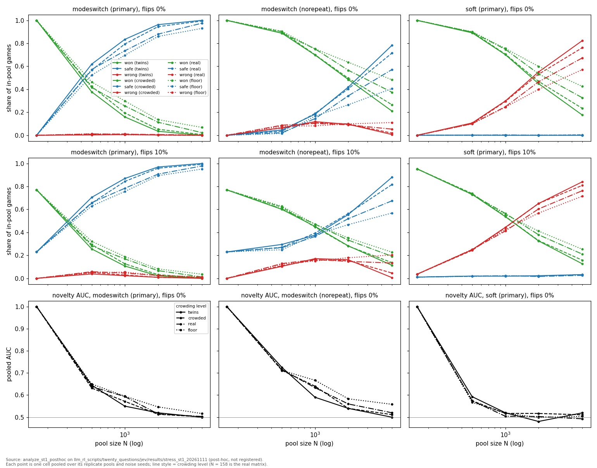

# ST-1 Crowding and scale — results

Scored against `STRESS_CROWDING_PREREG.md` as tagged `prereg-stress-st1-20261111`.
Build note and the mid-run deviation: `STRESS_ST1_BUILD.md`. Run directory:
`results/stress_st1_20261111` (1785 jobs × 1100 games; 51 pools; every job file
complete). Registered scoring: `analyze_st1` → `analysis.json` and four figures.
Post-hoc (not registered, labelled as such below): `analyze_st1_posthoc` →
`posthoc_by_n.json`, `posthoc_replicates.json`, `posthoc_trace.json`,
`fig_st1_posthoc_by_n.png`.

All numbers are deterministic replays of seeded jobs (Python 3.9, `PYTHONHASHSEED=0`);
a re-run reproduces them exactly. Where a range is quoted, it is the spread over the
cell's 3 replicate pools (`posthoc_replicates.json`); pooled values are over all its
games.

## Headline

1. **Size, not packing, is the stressor.** At a fixed 44-attribute vocabulary and a
   20-question budget, every backend degrades steeply from N = 158 to N = 500, and the
   four crowding levels barely separate at any N. Crowding rises with N on its own (a
   fixed attribute space fills up): every pool at N ≥ 500 has 69–100% of its objects
   within one attribute of a neighbour, against 62% for the real 158.
2. **P0a stays mostly safe at scale in the published arm, but only because the
   repeat loop burns the budget.** `modeswitch` (primary) keeps in-pool `wrong` at
   ≤ 0.013 with clean answers and ≤ 0.058 at 10% flips everywhere in the grid, while
   its win rate falls from 1.00 (N = 158) to 0.42 (N = 500, real level) and 0.02
   (N = 5000). The re-asked question appears in 57% of games at N = 500 and 98% at
   N = 5000 (P7 PASS), and every looping game in the grid ends as a safe escalation
   at the budget.
3. **Switching the loop off trades safe escalations for wins *and* for `wrong`.**
   With `no_repeat`, `modeswitch` wins 0.89 at N = 500 (real level, clean) instead of
   0.42, but in-pool `wrong` rises to 0.088 (replicates 0.075–0.111), and to 0.13 at
   10% flips. P0a's zero-wrong record does not survive scale once the loop is gone.
4. **The novelty detector is blind beyond a few hundred objects.** Pooled AUC falls
   from 1.000 at N = 158 to 0.57–0.70 at N = 500 and ≈ 0.50 at N = 5000, for every
   backend (P5 FAIL).
5. **The trajectory read that P2's failure requires found one new failure path**,
   specific to `modeswitch` and to novel secrets: when the live set empties within K
   turns of the budget, the reinstate-and-test spends the last turns re-guessing
   reinstated objects and the game ends pointing at a known object instead of
   escalating (210 games in the primary arm, 613 with `no_repeat`, all at flip 0).
   The other single-live `wrong` games are budget exhaustion counted one question
   late.

## Scorecard

| prediction | verdict | reading |
|---|---|---|
| P1 crowding costs questions before errors | primary FAIL (both), `no_repeat` PASS (both) | (a) holds but is nearly vacuous: only the four N = 158 flip-0 cells have q95 < 20. (b) guess share *falls* with identical-row fraction in the primary arm (Spearman −0.62), because the loop replaces guesses with re-asks; with `no_repeat` it rises (+0.46 `hard`, +0.43 `modeswitch`). **Attributed to the loop.** |
| P2 failures are the budget | FAIL, all four arm × backend | (a) budget-exhaustion share falls below 0.95 (min 0.15 primary `modeswitch` … 0.89 `no_repeat` `hard`); see *Trajectory read*. (b) `wrong` > 0 appears at N = 500 and at every crowding level, not first in the twins / N ≥ 2000 corner. |
| P3 crowding disarms the rescue | primary PASS, `no_repeat` FAIL | Recovery of `modeswitch` over `hard` vs crowding: Spearman −0.62 (primary), −0.60 (`no_repeat`). Rescue-trigger rate vs crowding: −0.51 (primary), −0.49 (`no_repeat`, misses −0.5 by 0.01). The recovery itself is small everywhere off the anchor: ≤ 0.016 in the primary arm at N ≥ 500 (`fig_st1_rescue.png`). |
| P4 noise moves the boundary in | FAIL, all four | Not because noise is harmless: `wrong` > 0.01 already occurs in the least-crowded cell of the grid (N = 500, floor, c = 0.687) at flip 0, so the boundary cannot move further in. A floor effect of the design. |
| P5 detector degrades, discrete first | FAIL | (a) AUC falls with crowding for every backend at every flip rate; (b) holds at 5% and 10% flips only through the N = 158 anchor; (c) fails at 10% flips (`hard`/`modeswitch` minimum at the real level). The detector has collapsed to ≈ 0.5 by N = 1000 for all backends, so there is no ordering left to test. |
| P6 real-matrix anchor | PASS | N = 158, 10% flips, primary: `wrong` 0 for both; `modeswitch` fail 0.230 < `hard` 0.244. |
| P7 crowding pulls the loop in | PASS | (a) repeat rate 0 at the anchor; (b) Spearman(repeat, crowding) +0.56; (c) twins at N ∈ {2000, 5000}: `no_repeat` wins 0.254 more than primary on average. |

The prereg's own falsification clauses that fired: **P2 failing** ("stop and read the
trajectories before interpreting anything else" — done below, before the rest of this
note was written) and the partial **P7 reading** (the loop is high-prior *and*
high-N: at N ≥ 500 the primary arm is confounded by it, so the `no_repeat` arm is the
reading of record for what crowding and size do to P0a's decisions).

## 1. Size dominates; crowding level barely matters

In-pool won / safe / wrong at the **real** crowding level (N = 158 is the real matrix),
pooled; replicate ranges in `posthoc_replicates.json`. From `analysis.json`.

| N | `modeswitch` primary, clean | `modeswitch` `no_repeat`, clean | `soft`, clean | `modeswitch` primary, 10% | `modeswitch` `no_repeat`, 10% | `soft`, 10% |
|---:|---|---|---|---|---|---|
| 158 | 1.00 / 0 / 0 | 1.00 / 0 / 0 | 1.00 / 0 / 0 | 0.77 / 0.23 / 0 | 0.77 / 0.23 / 0 | 0.95 / 0.01 / 0.036 |
| 500 | 0.42 / 0.57 / 0.012 | 0.89 / 0.02 / 0.088 | 0.90 / 0 / 0.101 | 0.28 / 0.66 / 0.058 | 0.60 / 0.27 / 0.129 | 0.73 / 0.02 / 0.251 |
| 1000 | 0.26 / 0.74 / 0.009 | 0.75 / 0.15 / 0.103 | 0.75 / 0 / 0.248 | 0.17 / 0.78 / 0.046 | 0.47 / 0.36 / 0.164 | 0.57 / 0.02 / 0.412 |
| 2000 | 0.11 / 0.88 / 0.006 | 0.57 / 0.34 / 0.091 | 0.54 / 0 / 0.465 | 0.07 / 0.91 / 0.026 | 0.33 / 0.52 / 0.148 | 0.38 / 0.02 / 0.604 |
| 5000 | 0.02 / 0.98 / 0.002 | 0.37 / 0.57 / 0.053 | 0.33 / 0 / 0.673 | 0.01 / 0.98 / 0.010 | 0.19 / 0.68 / 0.133 | 0.21 / 0.03 / 0.763 |

Across the four crowding levels at a fixed N, the same rates differ by a few points;
across N at a fixed level they move by tens of points (`fig_st1_posthoc_by_n.png`).
At flip 0, `hard` equals `modeswitch` on every in-pool game (a clean answer never
strikes the truth, so there is nothing to reinstate).



*Post-hoc. `analyze_st1_posthoc` on `results/stress_st1_20261111`. In-pool outcome
shares and pooled novelty AUC against pool size; line style = crowding level.*

Three regimes, by backend:

* **`soft`** has no safe escalation in-pool (its UNKNOWN mass is calibrated to the
  0.091 prior and is rarely on top for an in-pool secret), so every game it cannot
  finish within 20 questions is `wrong`: 0.10 at N = 500, 0.67 at N = 5000, clean.
* **The discrete backends, primary arm,** escalate almost every game they cannot
  finish. That escalation is the repeat loop (§2), not a decision.
* **The discrete backends with `no_repeat`** sit in between: they finish as often as
  `soft` (0.89 vs 0.90 at N = 500), escalate when many objects remain at the budget,
  and give a `wrong` answer when only a few remain.

## 2. The primary arm's safety at scale is the repeat loop

`hard` and `modeswitch` hold UNKNOWN at its prior, so once a question that splits
UNKNOWN from the knowns tops the EIG ranking it keeps its EIG and is asked every turn
(`STRESS_ST0.md`, Finding 2). The prereg chose the 0.091 prior to stay below that
threshold on the real pool, and at N = 158 it does (repeat rate 0). At N ≥ 500 the
threshold has moved below 0.091:

| N | twins | crowded | real | floor |
|---:|---:|---:|---:|---:|
| 500 | 0.62 | 0.57 | 0.57 | 0.53 |
| 1000 | 0.83 | 0.79 | 0.73 | 0.70 |
| 2000 | 0.96 | 0.94 | 0.88 | 0.86 |
| 5000 | 1.00 | 0.99 | 0.98 | 0.93 |

*Repeat rate (share of games that re-ask a non-guess question), `modeswitch` primary,
flip 0, from `analysis.json`. Within each N it rises with crowding (P7's mechanism),
but N moves it more.*

Every looping game in the primary arm's discrete cells (476,982 in-pool and 47,786
novel) runs to the budget and ends as a safe escalation. At the real level, flip 0,
those games end with at least 12 objects still live (median 25 at N = 500, 140 at
N = 5000).
UNKNOWN's fixed 0.091 then outweighs each known's share of the remaining mass, so the
budget-end rule calls the expert. Every non-looping game is either won or `wrong`.
So the primary arm's low `wrong` at scale is a by-product of the loop: it never gets
close enough to a single candidate to guess wrongly.

## 3. Novelty detection

Pooled AUC of p(UNKNOWN) max, flip 0, primary arm (`analysis.json`):

| N | `soft` | `hard` | `modeswitch` |
|---:|---|---|---|
| 158 | 1.000 | 1.000 | 1.000 |
| 500 | 0.57–0.59 | 0.68–0.70 | 0.63–0.65 |
| 1000 | 0.50–0.52 | 0.58–0.63 | 0.55–0.60 |
| 5000 | 0.49–0.52 | 0.50–0.52 | 0.50–0.52 |

*Ranges are across the four crowding levels.*

The held-out novel objects are drawn from the same generator as the pool, so at
N ≥ 500 each one has generated siblings in the pool that answer most attributes the
same way. Within 20 questions the backends can rarely rule out every look-alike, and
the discrete backends' signal needs the live set to empty. This is the hardest
version of the detection problem, and the generator may make it harder than real
catalogues would; it is still the regime a growing catalogue moves towards at a
fixed vocabulary.

## 4. Trajectory read (P2)

The prereg's falsification clause for P2 says that `wrong` games with fewer than 2
live knowns at turn 20 indicate a failure path the design missed, and to read the
trajectories first. `analyze_st1_posthoc --trace` replays every such flip-0 game
(deterministically; each replay is asserted to reproduce the stored outcome and live
count) and classifies its last turn (`posthoc_trace.json`):

| arm / backend | `wrong` games, in-pool / novel | single-live, narrowed on turn 20 | single-live, reinstate overrun |
|---|---|---|---|
| primary `hard` | 252 / 129 | 48 in-pool, 46 novel | — |
| primary `modeswitch` | 252 / 339 | 48 in-pool, 46 novel | **210 novel** |
| `no_repeat` `hard` | 3847 / 1283 | 146 in-pool, 162 novel | — |
| `no_repeat` `modeswitch` | 3847 / 1896 | 146 in-pool, 162 novel | **613 novel** |

* **Narrowed on turn 20** (all `hard` cases, all in-pool `modeswitch` cases): two or
  more objects were live before question 20, and its answer — usually a refuted
  by-name guess of a twin — left one, with no turn left to guess it. That is budget
  exhaustion; the metric counts the live set one question too late. No in-pool
  `wrong` game confirmed a wrong object (`false_confirm` = 0 throughout).
* **Reinstate overrun** (`modeswitch`, novel secrets only): the guesses of the novel
  object's look-alikes empty the live set within K = 3 turns of the budget;
  `modeswitch` reinstates and tests a candidate by name each turn (often an unrelated
  object, e.g. a vehicle for a novel office-supplies item), and the budget runs out
  mid-test with a reinstated known on top, so the game ends `wrong`. `hard` in the
  same position escalates: the empty live set puts UNKNOWN on top. This is the
  failure path the design note missed: **the reinstate test is not budget-aware**, and
  near the budget it converts escalations on novel secrets into `wrong` answers.
  It accounts for `modeswitch`'s whole excess of novel `wrong` games over `hard`.

The analyzer's budget-exhaustion share pools in-pool and novel `wrong` games, as the
registered Metrics section reads; the P2 verdict stands as scored.

## 5. What the anchor confirms

At N = 158 on the real matrix the snapshot harness reproduces the retraction study's
picture: zero `wrong` for both discrete backends at every flip rate, and `modeswitch`
recovering a little over `hard` at 10% flips (fail 0.230 vs 0.244; AUC 0.885 vs 0.878).
`soft` wins most (0.95) but is the only backend with in-pool `wrong` (0.036). Nothing
in this study contradicts the published N = 158 results.

## Consequences for the production rule

These are readings for a decision, not decisions; none is made here.

* **P0a's guarantees are measured for N ≈ 150 at a 44-attribute vocabulary and a
  20-question budget.** Its zero-wrong property does not extend to larger pools by
  itself; in the published arm it survives only through the loop, which also
  forfeits most wins.
* **`no_repeat` is not a free fix at scale.** At N = 158 it changes nothing at this
  prior. At N ≥ 500 it recovers about as many wins as `soft` gets, and turns part of
  the loop's escalations into `wrong` answers: up to 0.12 clean and 0.20 at 10% flips
  across the grid (at the real level, 0.05–0.10 clean and 0.13–0.16 at 10% flips). Whether that trade is acceptable depends on the cost ratio of a wrong
  answer to an escalation, which this study does not set.
* **The reinstate test should be budget-aware.** A one-line guard (reinstate only if
  the remaining budget can finish the test, else escalate) would remove the overrun
  path without changing anything at N = 158, where it never fires. It needs its own
  gate before adoption. *(Since done: built and gated in `STRESS_REINSTATE_GUARD.md`,
  all gates pass, and adopted as P0a as `modeswitch_guard` on 2026-11-12. The results
  above are for unguarded `modeswitch`, as registered.)*
* **Scale needs vocabulary.** Every failure here traces back to too few attributes for
  the pool: pools whose objects all have near-twins cannot be split in 20 questions.
  The prereg's *Out of scope* follow-on (grow the question bank with N) is now the
  first-order question for scale, ahead of further belief-backend work.

## Caveats

* **Crowding and N are confounded.** The generator cannot produce a large pool less
  crowded than about 0.69 at this vocabulary, and crowding rises with N. The registered
  Spearman tests run across all cells, so they mix the two; the within-N rows above
  are the cleaner reading of crowding alone, and there its effect is small.
* **The novel set shares the pool's generator** (§3), which makes detection about as
  hard as it can be.
* **P1(a) was nearly vacuous** (four qualifying cells), and P4 hit a floor effect; both
  are properties of where the grid's failures start, not evidence either way about the
  mechanisms.
* **Mid-run speed change.** The planner gained a closed-form guess EIG after 60 jobs,
  and the runner pinned BLAS to one thread. The gates show identical games, and a
  later side-by-side probe shows the closed form is speed-neutral (the BLAS pin was
  the whole speedup). Details and segments: `STRESS_ST1_BUILD.md`, *Mid-run change*.

## Reproduce

```
# the grid (resumable; finished jobs are skipped)
PYTHONHASHSEED=0 PYTHONPATH=. /opt/miniconda3/envs/LLM_RL/bin/python -m \
    llm_rl_scripts.twenty_questions.jev.stress_st1 --run \
    --prereg-tag prereg-stress-st1-20261111 --soft-max-n 5000 \
    --outdir llm_rl_scripts/twenty_questions/jev/results/stress_st1_20261111 --workers 6
# registered scoring + figures
PYTHONHASHSEED=0 PYTHONPATH=. /opt/miniconda3/envs/LLM_RL/bin/python -m \
    llm_rl_scripts.twenty_questions.jev.analyze_st1 \
    --dir llm_rl_scripts/twenty_questions/jev/results/stress_st1_20261111
# post-hoc tables, figure, replicate ranges and the P2 trajectory read
PYTHONHASHSEED=0 PYTHONPATH=. /opt/miniconda3/envs/LLM_RL/bin/python -m \
    llm_rl_scripts.twenty_questions.jev.analyze_st1_posthoc \
    --dir llm_rl_scripts/twenty_questions/jev/results/stress_st1_20261111 --trace
```
